<h1 data-importer="text" align="center">Hey 👋What's Up?</h1>

###

  
  
  
  
  
  
  
  
  
  
  
  
  
  
  
  
  

name: Generate stats card

on:
  schedule: # execute every 12 hours
    - cron: "* */12 * * *"

  workflow_dispatch:

  push:
    branches:
    - main

jobs:
  generate:
    permissions:
      contents: write
    runs-on: ubuntu-latest
    timeout-minutes: 5

    steps:
      - name: generate stats.svg
        uses: readme-tools/github-readme-stats-action@v1
        with:
          card: stats
          options: username=${{ github.repository_owner }}&hide_title=false&hide_rank=false&show_icons=true&include_all_commits=true&count_private=true&disable_animations=false&theme=codeSTACKr&locale=en&hide_border=false
          path: dist/stats.svg
          token: ${{ secrets.GITHUB_TOKEN }}

      - name: push stats.svg to the output branch
        uses: crazy-max/ghaction-github-pages@v3.1.0
        with:
          target_branch: stats-output
          build_dir: dist
        env:
          GITHUB_TOKEN: ${{ secrets.GITHUB_TOKEN }}

###

  
  
  

###

  
  
  

###

<picture data-importer="pacman">
  <source media="(prefers-color-scheme: dark)" srcset="https://raw.githubusercontent.com/Alphathesniper21/Alphathesniper21/pacman-output/pacman-contribution-graph-dark.svg?game=pacman">
  <source media="(prefers-color-scheme: light)" srcset="https://raw.githubusercontent.com/Alphathesniper21/Alphathesniper21/pacman-output/pacman-contribution-graph.svg?game=pacman">
  
</picture>

###
